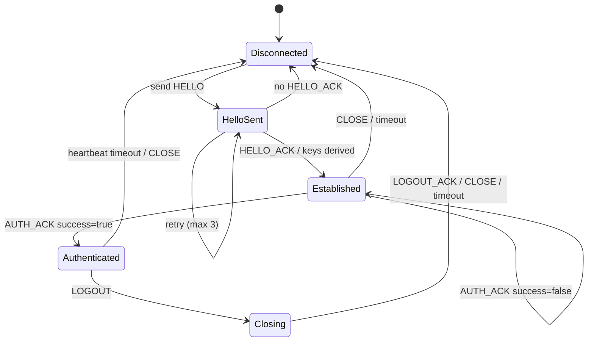
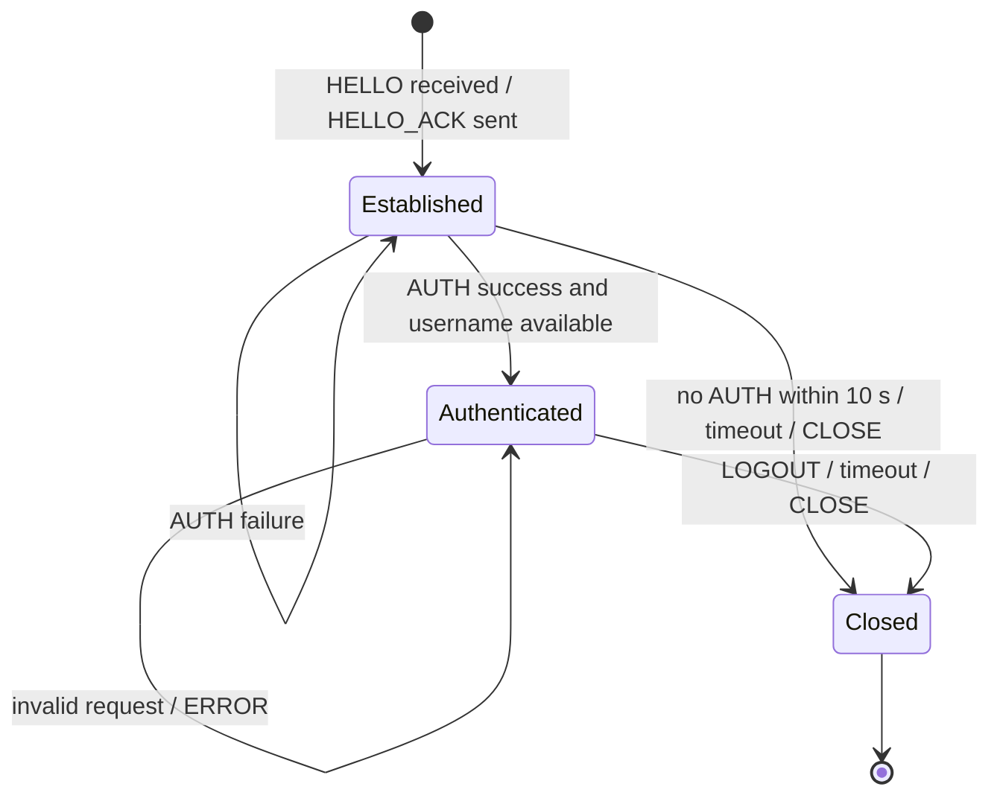
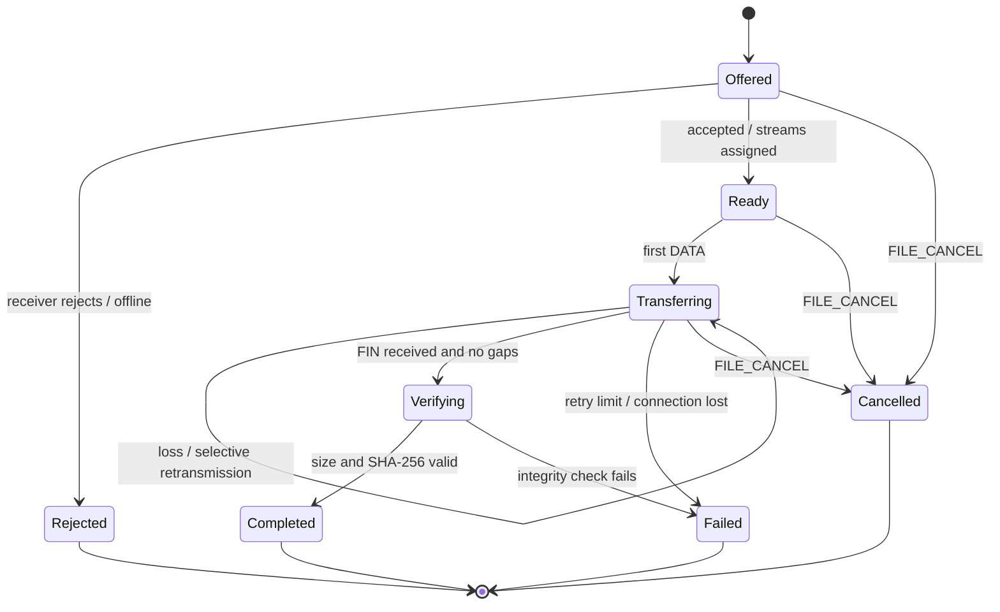

# Protocol Specification
## Distributed and Streaming-Based Client-Server Collaboration Application

**Status:** Milestone 1 design draft (revision 2)  
**Language:** Python (`socket`)  
**Architecture:** Central client-server, server relays messages and files  
**Protocol version:** 1


## 1. Scope

- Connection establishment and acknowledgment over UDP.
- Authentication and one active session per username.
- Online-user list and presence updates.
- Broadcast and private messaging.
- File transfer using chunks, acknowledgments, selective retransmission, reassembly, and integrity checks.
- Heartbeat, timeout handling, graceful logout, and protocol errors.
- Payload encryption.
- Browser UI served by a local HTTP server on the client machine.

Revision 2 replaces the TCP control channel of revision 1. The message types, session rules, and error codes of revision 1 are kept; they now run on UDP streams.

## 2. Transport decisions

| Function | Transport | Reason |
|---|---|---|
| Handshake, authentication, presence, chat, control | UDP (CCP) | Instructor: the work is implemented over UDP; TCP would leave no protocol work |
| File data | UDP (CCP) | Step 6 requires chunking and reassembly over UDP |
| Heartbeat | UDP (CCP) | Matches the stated UDP use case |
| HTML/JS delivery to the browser | TCP (HTTP) | Browsers cannot use UDP; HTTP only carries the page content |

CCP is the working name of the application-layer protocol (Collaboration Channel Protocol). It provides sequencing, acknowledgment, retransmission, and flow/congestion control on top of UDP datagrams.

Max datagram size is **1200 bytes** to reduce IP-fragmentation risk.

## 3. Architecture

Components:

| Component | Role |
|---|---|
| Server | One UDP socket (default port 9000). Tracks sessions, routes messages, relays files |
| Client agent | One UDP socket towards the server and an HTTP server on the StreapRous raw-socket TCP, bound to the machine's own network address (the raw-socket mode refuses `127.0.0.1`, see 13.1). Implements all protocol logic |
| Browser UI | HTML and client-side JavaScript only. Displays state and sends user commands to the agent |

Layers inside the server and the agent:

| Layer | Responsibility |
|---|---|
| UDP socket | Send and receive datagrams |
| Packet layer | Header, packet numbers, encryption, ACK/SACK, RTO, flow and congestion control |
| Stream layer | Independent byte streams per connection, each with its own reordering buffer |
| Message layer | JSON control messages and raw file bytes |

Network logic, data processing, and UI are kept in separate modules. The server is a relay; direct peer-to-peer transfer is out of scope.

## 4. UDP packet format

Every datagram starts with a 16-byte header. All integers are big-endian.

| Field | Size | Meaning |
|---|---:|---|
| `magic` | 2 bytes | `0xA5C3`; datagrams with another value are dropped |
| `version` | 1 byte | `1` |
| `type` | 1 byte | Packet type |
| `flags` | 1 byte | bit0 `FIN`, bit1 `ENC` |
| `reserved` | 1 byte | `0` |
| `connection_id` | 4 bytes | `0` in HELLO; assigned by the server afterwards |
| `packet_number` | 4 bytes | Per-direction counter, increases by 1 for every packet sent |
| `payload_length` | 2 bytes | Number of bytes after the header |

A packet number is never reused. Lost data is retransmitted in a new packet with a new packet number. This keeps RTT samples unambiguous and keeps the encryption nonce unique.

### Packet types

| Code | Type | Purpose |
|---|---|---|
| `0x01` | `HELLO` | Client opens a connection |
| `0x02` | `HELLO_ACK` | Server accepts and assigns `connection_id` |
| `0x03` | `DATA` | Carries one stream segment |
| `0x04` | `ACK` | Acknowledges received packets |
| `0x05` | `PING` | Heartbeat request |
| `0x06` | `PONG` | Heartbeat reply |
| `0x07` | `CLOSE` | Close the connection |

A `DISCOVER` broadcast packet (`0x08`) for finding the server on the LAN is optional and not part of the required steps.

### HELLO and HELLO_ACK payload

| Packet | Payload |
|---|---|
| `HELLO` | `client_public_key` (32 bytes, X25519), `client_nonce` (16 bytes) |
| `HELLO_ACK` | `server_public_key` (32 bytes), `server_nonce` (16 bytes) |

Both packets are sent without encryption. All other packets use the `ENC` flag once keys are derived (see section 12).

### DATA payload

| Field | Size | Meaning |
|---|---:|---|
| `stream_id` | 4 bytes | Stream the segment belongs to |
| `offset` | 8 bytes | Byte offset of the segment inside the stream |
| `data` | up to 1000 bytes | Stream bytes |

The `FIN` flag marks the last segment of a stream. Total stream length is `offset + len(data)` of that segment.

### ACK payload

| Field | Size | Meaning |
|---|---:|---|
| `largest_acked` | 4 bytes | Highest packet number received |
| `recv_window` | 4 bytes | Number of additional packets the receiver can buffer |
| `range_count` | 1 byte | Number of ranges |
| `ranges` | 8 bytes each | `[start, end]` packet number ranges received, inclusive |

The ranges are the selective acknowledgment. If they do not fit in one datagram, the most recent ranges are sent.

`ACK`, `PING`, `PONG`, and `CLOSE` are not retransmitted and do not count against the congestion window. They still consume packet numbers.

### CLOSE payload

One byte reason code: `0` normal, `1` timeout, `2` protocol error, `3` server shutdown.

## 5. Streams

| Stream ID | Use |
|---|---|
| 0 | Control: authentication, user list, presence, file negotiation |
| 1 | Chat: broadcast and private messages |
| 4 and above | One stream per file transfer; ID assigned by the server in `FILE_READY` |

Streams 0 and 1 carry framed JSON: `[4-byte unsigned length, big-endian][JSON UTF-8 body]`. The length counts the body only. Proposed maximum message size: **64 KiB**. A stream is a byte stream, so one message can span several segments and one segment can hold several messages.

File streams carry raw file bytes without framing. The expected size comes from `FILE_OFFER`.

Each stream has its own receive buffer. Out-of-order segments wait until the gap is filled and are then delivered in order. Duplicate segments (same `offset`) are ignored. A lost packet on one stream does not delay delivery on another stream, so file transfer does not block chat (no head-of-line blocking across streams).

## 6. Reliability, flow control, congestion control

### Reliability
- The sender keeps a record per unacknowledged `DATA` packet: packet number, stream ID, offset, length, send time.
- A packet is considered lost if three packets sent after it have been acknowledged, or if its RTO expires.
- Lost data is resent in a new packet. Only the missing data is retransmitted.
- The receiver sends an `ACK` after every 2 `DATA` packets, after 25 ms, or immediately when a gap is detected. (The client follows this rule; the server acknowledges every `DATA` packet at once.)
- If the same data is retransmitted 8 times without acknowledgment, the connection is closed with reason `1` and active file transfers fail.
- The server applies the same rules to streams 0 and 1 in both directions: it acknowledges every `DATA` packet, orders segments by `offset`, ignores a segment whose offset it already has (a resent packet has a new packet number but the same offset), and cuts the byte stream into frames. Control and chat frames that the client has not acknowledged within 0.5 s are sent again with a new packet number (at most 8 times). A frame is split into segments of at most 1000 bytes. The server also copies file segments from the sender's stream to the receiver's stream and resends the ones the receiver does not acknowledge.

### RTO
RFC 6298 style: `RTO = SRTT + 4 * RTTVAR`. Initial value 1 s, minimum 200 ms, doubled after each timeout. RTT samples are taken only from packets that were sent once.

### Flow control
Send window = `min(cwnd, recv_window)` using the `recv_window` from the latest `ACK`. Flow control is per connection. Per-stream flow control is not defined in this version. The server computes the `recv_window` it advertises as 256 minus the packets it holds for reassembly on streams 0 and 1 (`ClientSession.get_server_recv_window`). When that value is 0 it answers a new `DATA` packet with an `ACK` that advertises window 0 and does not process the packet. **Known gap:** the count of held packets is read from an attribute (`streams`) that the session does not have (the reassembly state is `recv_streams`), so the advertised window is always 256 today. The server does not yet use the client's `recv_window` when it sends.

### Congestion control
Planned in stages:

1. Fixed window (16 packets).
2. Slow start and AIMD (NewReno-like), initial `cwnd` of 10 packets.
3. CUBIC, if time allows.

BBR is not planned. The report must state only the stage that is actually implemented.

**Not final yet:** The instructor has not stated the minimum accepted congestion-control scope. Confirm whether AIMD is acceptable or CUBIC/BBR is expected.

### Heartbeat
An idle endpoint sends `PING` after 5 s without sending any packet. The peer answers with `PONG`. If nothing is received from the peer for 15 s, the connection is considered dead: the server removes the session and emits `PRESENCE: offline`; the client returns to `Disconnected`.

## 7. Connection lifecycle

1. Client sends `HELLO` (up to 3 attempts, 1 s apart).
2. Server creates the connection entry, assigns `connection_id`, and replies `HELLO_ACK`. A `HELLO` without a client public key is ignored (encryption is required, see section 12).
3. Both sides derive the session keys. The connection is `Established` but not authenticated.
4. Client sends `AUTH` on stream 0. The server closes connections that do not authenticate within 10 s.
5. After successful authentication the server sends `AUTH_ACK`, `USER_LIST`, and notifies other clients with `PRESENCE`.
6. Client ends the session with `LOGOUT` and `CLOSE`.

The server checks `connection_id` and the source address (IP, port) of every packet. Packets that do not match a known connection are dropped, except `HELLO`.

This exchange is the connection handshake and acknowledgment required by Step 2, implemented over UDP.

## 8. Message format and types

Control messages are JSON objects on streams 0 and 1.

| Field | Type | Meaning |
|---|---|---|
| `type` | string | Message type |
| `payload` | object | Message-specific data |
| `id` | string | Message/request identifier |
| `version` | integer | Protocol version; currently `1` |

Example:

```json
{
  "type": "MSG",
  "payload": {"target": "quoc", "text": "Hello Quoc!"},
  "id": "req-1042",
  "version": 1
}
```

Rules:
- Direct responses reuse the request's `id`.
- Server-originated events such as `PRESENCE` and `MSG_DELIVER` receive their own IDs.
- IDs support correlation. Exactly-once, in-order delivery is provided by the stream layer.
- Reject malformed JSON, missing fields, invalid field types, unsupported versions, and unknown message types.
- Send `ERROR` only when enough of the message is valid to construct a safe response; otherwise discard it.

`C → S`: client to server. `S → C`: server to client.

| Type | Direction | Stream | Required payload | Purpose |
|---|---|---:|---|---|
| `AUTH` | C → S | 0 | `username`, `password` | Authenticate |
| `AUTH_ACK` | S → C | 0 | `success`, `username`, `error` | Login result; error is null on success |
| `USER_LIST_REQ` | C → S | 0 | `{}` | Request current online users |
| `USER_LIST` | S → C | 0 | `users: [{username, ip, port, status}]` | Online-user snapshot |
| `PRESENCE` | S → C | 0 | `username`, `status` | Online/offline event |
| `MSG` | C → S | 1 | `target`, `text` | Send private or broadcast message |
| `MSG_DELIVER` | S → C | 1 | `sender`, `target`, `text`, `timestamp` | Deliver message |
| `FILE_OFFER` | C → S | 0 | `target`, `filename`, `size_bytes`, `sha256` | Sender requests a transfer |
| `FILE_INCOMING` | S → C | 0 | `file_id`, `sender`, `filename`, `size_bytes`, `sha256` | Notify the receiver |
| `FILE_RESPONSE` | C → S | 0 | `file_id`, `accepted` | Receiver accepts or rejects |
| `FILE_ACCEPT` | S → C | 0 | `file_id`, `accepted`, `error` | Tell the sender the result |
| `FILE_READY` | S → C | 0 | `file_id`, `stream_id`, `chunk_size` | Stream assigned for the transfer |
| `FILE_COMPLETE` | C/S → S/C | 0 | `file_id`, `success`, `sha256` | Report completion/integrity |
| `FILE_CANCEL` | C/S → S/C | 0 | `file_id`, `reason` | Cancel a transfer |
| `LOGOUT` | C → S | 0 | `{}` | End session |
| `LOGOUT_ACK` | S → C | 0 | `success` | Confirm logout processing |
| `ERROR` | S → C | 0 | `code`, `message`, `related_type` | Report error |

`target: "*"` means broadcast; a username means private message. Offline messages are not queued. The `ip` and `port` in `USER_LIST` are the UDP endpoint of the user as seen by the server.

## 9. Authentication, session, and presence rules

1. Each connection starts as `UNAUTHENTICATED` after the handshake.
2. Only `AUTH` is accepted before login; other messages receive `ERROR: NOT_AUTHENTICATED`.
3. Credentials are checked against a server-side user file. Passwords are stored as salted PBKDF2 hashes.
4. Only one active session per username. A second login receives `AUTH_ACK` with `success: false` and `ALREADY_LOGGED_IN`.
5. Failed authentication does not close the connection; the client may retry. After 5 failures the server closes the connection.
6. An authenticated connection that sends `AUTH` again receives `ERROR: ALREADY_AUTHENTICATED`.
7. The server session record contains: username, `connection_id`, IP address, UDP port, state, last activity time, and active transfers.
8. After successful login, send `AUTH_ACK`, then `USER_LIST`; notify other authenticated clients with `PRESENCE: online`.
9. On logout, timeout, or unexpected disconnect, remove the session and send `PRESENCE: offline` only if the state actually changed.
10. Cleanup must verify that the disconnecting connection still owns the username.
11. Never log passwords.

## 10. Message routing

### Private message
1. Client sends `MSG` with a username in `target`.
2. Server validates sender authentication and payload.
3. Unknown target → `ERROR: USER_NOT_FOUND`.
4. Existing but offline target → `ERROR: USER_OFFLINE`; do not queue.
5. Online target → forward `MSG_DELIVER`.
6. Forwarding does not mean the recipient has read the message.

### Broadcast
1. Client sends `MSG` with `target: "*"`.
2. Server validates sender and text.
3. Server forwards `MSG_DELIVER` to all other authenticated clients; the sender is not echoed in the initial version.
4. Each connection has its own send queue. A slow or failed recipient must not block or crash delivery to other clients.

## 11. File transfer

Sender A, receiver B, server S. S relays the data over two independent reliable connections (A to S, S to B).

1. A computes file size and SHA-256 and sends `FILE_OFFER`.
2. S checks that B is online, creates `file_id`, and sends `FILE_INCOMING` to B.
3. B answers with `FILE_RESPONSE`. S informs A with `FILE_ACCEPT`. If rejected, the transfer ends (`FILE_REJECTED`).
4. If accepted, S assigns one file stream on each connection and sends `FILE_READY` to both. The stream IDs may differ per connection. `chunk_size` is 1000.
5. A writes the file into its stream. The stream layer splits it into `DATA` packets with offsets; the last one carries `FIN`.
6. S copies each segment from A's stream to B's stream as soon as it arrives, keeping the offset and the `FIN` flag. Segments that B does not acknowledge within 0.5 s are sent again (up to 8 times). **Not implemented:** the bounded relay buffer (proposed 256 KiB) and slowing A down through `recv_window`; the server forwards at once and keeps no file data.
7. B writes received bytes to a temporary file at the given offsets. When `FIN` is received and no gap remains, B checks file size and SHA-256, then sends `FILE_COMPLETE`. S forwards the result to A.
8. Either side can send `FILE_CANCEL`. If the connection dies during a transfer, the transfer fails and the partial file is deleted.

Rules:
- `file_id` is assigned by the server.
- File bytes are sent raw, not as JSON or base64.
- A transfer is successful only after the receiver verifies file size and SHA-256 and completion is reported.
- Reject `DATA` for unknown streams, offsets beyond the announced file size, and invalid payload lengths.
- Duplicate segments must not change the received file.

Implementation notes (`src/server/file_relay.py`):
- The server assigns file stream IDs per connection, starting at 4 and increasing by one for each accepted transfer on that connection.
- `FILE_OFFER` needs `target`, `filename`, `size_bytes` (0 to 1 GiB) and a 64-digit hexadecimal `sha256`; otherwise the server answers `ERROR: INVALID_PAYLOAD`. An unknown target or the sender's own name gives `USER_NOT_FOUND`; a known user who is offline gives `USER_OFFLINE`.
- `FILE_ACCEPT` and a later `ERROR` for the offer carry the `id` of the sender's `FILE_OFFER`, so the sender can match them. A rejection is reported as `FILE_ACCEPT` with `accepted: false` and an `error` text.
- If either user disconnects during a transfer, the server sends `FILE_CANCEL` (reason `the other user disconnected`) to the other one and forgets the transfer.
- A reply for a transfer the server does not know (`FILE_RESPONSE`, `FILE_COMPLETE`, `FILE_CANCEL`) is `ERROR: TRANSFER_NOT_FOUND`.

## 12. Security

- Key exchange: X25519 in `HELLO` / `HELLO_ACK`.
- Key derivation: HKDF-SHA256 with `client_nonce || server_nonce` as salt, producing one key per direction.
- Payload encryption: AES-256-GCM using the `cryptography` package.
- Nonce: 1 byte direction, 3 zero bytes, 8 bytes packet number. The 16-byte header is the additional authenticated data.
- Packets that fail authentication are dropped without a reply.
- Passwords travel only inside encrypted `AUTH` messages and are stored hashed with salt.
- Limitation: the server relays messages and files, so encryption is hop-by-hop and the server can read the content. End-to-end encryption is out of scope.
- Limitation: `HELLO` is not authenticated, so a man-in-the-middle attack during the handshake is not prevented. Pinning the server public key in the client configuration is a possible improvement.
- The server requires encryption: after `HELLO` a packet without the `ENC` flag is dropped, and a `HELLO` without a client key is ignored. The server option `--allow-plaintext` turns this off for development only.

## 13. Web UI and local HTTP API
### 13.1 StreapRous constraints

Measured on Windows (Python 3.11, Chrome) against an unmodified copy. The API below is shaped by them.

- **Start-up:** the assignment requires HTTP over raw sockets, so the agent calls the stock `daemon.backend.create_backend(ip, port, app.routes)`: Linux, root, and an address that is not `127.0.0.1`. Tested on WSL2 with the browser on Windows. Two host settings are needed: the WSL interface MTU must be 1500 (default 1280 makes the framework's 1460-byte segments fail with `Message too long`), and the kernel's RST for the agent port must be dropped (`iptables -A OUTPUT -p tcp --sport <port> --tcp-flags RST RST -j DROP`). The agent has no other mode: normal OS TCP sockets are not accepted.
- **Routes match the exact path.** `?query` and path parameters give `404`, so every parameter travels in a JSON body and every API call is a `POST`.
- **A request is read with one `recv(1024)`, headers included.** Chrome headers take about 600 bytes, so the JSON body must stay **under 350 bytes** (400 B worked 15/15, 500 B failed 15/15). Chat text is limited to **250 bytes of UTF-8**.
- **The status line is always `HTTP/1.1 200`.** Errors are reported in the body only.
- Responses have no size limit. Long-polling works: 10 held requests at once, other requests are not blocked. Static files: `.html` from `www/`, `.js` from `static/`.

### 13.2 Conventions

- The agent serves the UI files that sit in the framework folders: `www/chat.html` and `static/api.js`, `static/app.js` (no stylesheet). Open `http://127.0.0.1:8080/chat.html`; `/` stays the framework's sample page. Page and API share one origin.
- JSON in both directions. Success: `{"ok": true, ...}`. Failure: `{"ok": false, "code": "<section 14 code>", "message": "..."}`, still with HTTP `200`.
- A command is answered when the agent has accepted it; the result arrives as an event. Not logged in: `NOT_AUTHENTICATED`. Bad JSON or fields: `INVALID_PAYLOAD`.

### 13.3 Endpoints (all `POST`, JSON body)

| Endpoint | Request | Response | CCP message |
|---|---|---|---|
| `/api/login` | `{"username", "password"}` | `{"ok": true}` | `HELLO` if disconnected, then `AUTH`. Result: `auth_ack` event |
| `/api/send` | `{"target", "text"}` (`target` is `"*"` or a username; text up to 250 bytes) | `{"ok": true}` | `MSG`. Unknown/offline target: `error` event |
| `/api/file/offer` | `{"target", "filename"}` (`filename` is a file name inside the agent's `share` folder) | `{"ok": true, "ref": "<id>", "filename", "size_bytes"}` | The client computes size and SHA-256 and sends `FILE_OFFER` |
| `/api/file/respond` | `{"file_id", "accepted"}` | `{"ok": true}` | `FILE_RESPONSE` |
| `/api/logout` | `{}` | `{"ok": true}` | `LOGOUT`, `CLOSE` |
| `/api/events` | `{"since": <n>}` | `{"events": [...], "next": <n>}` | - |

The server does not echo a sender's own messages, so the UI shows its own message locally after `ok`. File bytes never pass through the browser: the agent reads the file itself, and only from its `share` folder (a name that leaves the folder is refused with `INVALID_PAYLOAD`). `ref` is the id of a sent file; the `file` events of that transfer carry the same value as `file_id`. If the server refuses an offer, the agent sends an `error` event and a `file` event with `state: "rejected"`.

### 13.4 Events (long-polling)

`/api/events` returns events with `seq > since`. If there are none, the agent holds the request up to 25 s, then answers `{"events": [], "next": <since>}`. The page calls again with `since=<next>`. `since=0` returns a snapshot: current `conn`, then `auth_ack`, `user_list` and one `file` event per unfinished transfer (no chat history).

| `type` | Fields | Source |
|---|---|---|
| `conn` | `state`: `disconnected`, `connecting`, `established`, `authenticated`, `closing` | Client state machine (section 15) |
| `auth_ack` | `success`, `username`, `error` | `AUTH_ACK` |
| `user_list` | `users: [{username, ip, port, status}]` | `USER_LIST` |
| `presence` | `username`, `status` | `PRESENCE` |
| `msg` | `sender`, `target`, `text`, `timestamp` (Unix seconds) | `MSG_DELIVER` |
| `file_incoming` | `file_id`, `sender`, `filename`, `size_bytes` | `FILE_INCOMING` |
| `file` | `file_id`, `ref`, `direction` (`send`/`recv`), `peer`, `filename`, `size_bytes`, `state`, `transferred_bytes` | Transfer state |
| `error` | `code`, `message`, `related_type` | `ERROR` |

`file.state` is the lower-case state from the file transfer diagram (section 15). It is sent on every change and, while `transferring`, at most about 4 times per second. `completed` is sent only after size and SHA-256 are verified.

### 13.5 Open issues

- Open point: adding the three UI files to `CO3094_streaprous/www/` and `static/` needs to be confirmed as acceptable. The agent and the UI files only add files; they do not edit existing framework files.
- File selection: a browser cannot hand a file to this framework (see 13.1), so the user types the name of a file placed in the agent's `share` folder. Restricting the agent to that folder matters because the raw-socket API listens on a LAN address and has no login of its own: without it anyone on the network could ask the agent to send any file of the machine.
- The local API is not authenticated: anyone who can reach the agent's port can act as the logged-in user. Acceptable for a LAN demo, not for a real deployment.
- Received files: the agent should move the verified file to a `downloads/` folder; there is no download endpoint yet.

## 14. Error codes

| Code | Meaning |
|---|---|
| `INVALID_PACKET` | Packet or message malformed or violates format |
| `UNSUPPORTED_VERSION` | Version not supported |
| `UNKNOWN_MESSAGE_TYPE` | Unknown type |
| `INVALID_PAYLOAD` | Required field missing or invalid |
| `AUTH_FAILED` | Invalid credentials |
| `ALREADY_LOGGED_IN` | Username already has an active session |
| `ALREADY_AUTHENTICATED` | Connection is already logged in |
| `NOT_AUTHENTICATED` | Authentication required |
| `USER_NOT_FOUND` | Target does not exist |
| `USER_OFFLINE` | Target exists but is offline |
| `FILE_REJECTED` | File transfer rejected |
| `TRANSFER_NOT_FOUND` | Unknown/expired transfer ID |
| `TRANSFER_FAILED` | Retry limit or integrity check failed |
| `INTERNAL_ERROR` | Unexpected server-side error |

## 15. State diagrams

### Client connection/session



### Server session per connection



### File transfer per file ID



## 16. Logout and error handling

- For valid `LOGOUT`, send `LOGOUT_ACK`, remove session, emit offline presence, and send `CLOSE`.
- Unexpected disconnects and heartbeat timeouts must also clean up sessions and active transfers.
- Packets with a wrong magic, version, connection ID, or failed decryption are dropped, and so are packets without the `ENC` flag after `HELLO`.
- A message frame with length 0 or above 64 KiB on stream 0 or 1 is a protocol error: the server closes the connection with reason `2`.
- Socket errors, malformed packets, timeouts, and cancellations must not crash the server or affect unrelated clients. The receive loop catches exceptions, logs them, and continues.

## 17. Default parameters (tunable)

| Parameter | Value |
|---|---|
| Server UDP port | 9000 |
| Agent HTTP port | 8080 |
| Max datagram | 1200 bytes |
| `DATA` segment size | 1000 bytes |
| Initial `cwnd` | 10 packets (fixed window 16 in stage 1) |
| Initial RTO / minimum RTO | 1 s / 200 ms |
| Heartbeat interval / timeout | 5 s / 15 s |
| Authentication deadline | 10 s |
| `HELLO` attempts | 3 |
| Max retransmissions of the same data | 8 |
| Max control message | 64 KiB |
| Server relay buffer per transfer | not used (segments are forwarded at once) |
| Server resend of control, chat and file segments | after 0.5 s without `ACK`, at most 8 times; checked every 0.25 s |
| Server `recv_window` | 256 packets minus packets held for reassembly (always 256 today, see section 6) |
| Maximum file size accepted by the server | 1 GiB |

